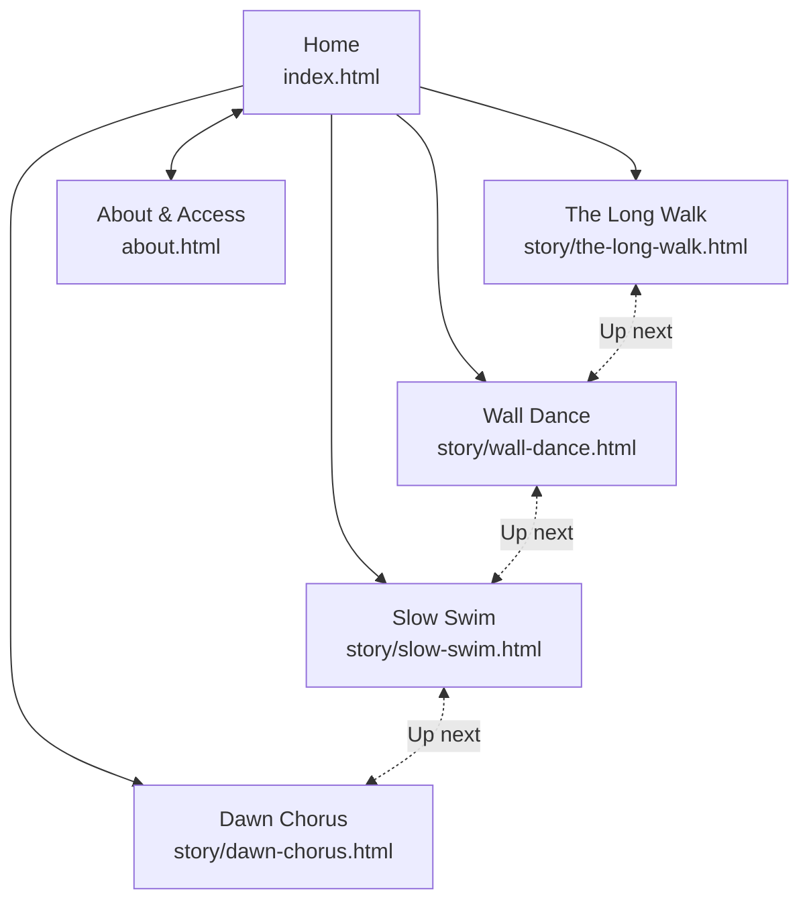

# StoryCast: Everyday Voices

An accessible, three-page-type microsite for short audio and video stories told by ordinary people. It is built with semantic HTML5, Sass and vanilla JavaScript (no frameworks), styled after Google's Material 3 design system, and targets **WCAG 2.1 AA**.

## Deliverables

| Deliverable | Location |
| --- | --- |
| Research document (PDF) | [`docs/research.pdf`](docs/research.pdf) (source: `docs/research.html`) |
| Sitemap (diagram) | [`docs/sitemap.svg`](docs/sitemap.svg) |
| Wireframes (link) | [Wireframes page on Figma](https://www.figma.com/design/GPUgX9O6oZdRDJkFPEPqra?node-id=19-2): Home, Story and About & Access, desktop and mobile (also in the research PDF, section 6) |
| High-fidelity mockups (link) | [StoryCast: Everyday Voices on Figma](https://www.figma.com/design/GPUgX9O6oZdRDJkFPEPqra): all 6 pages at desktop (1440px) and mobile (390px) |
| Documentation (PDF) | [`docs/documentation.pdf`](docs/documentation.pdf) (generated from this README) |
| Codebase | this repository |

## Sitemap



Every page shares the same header (skip link, Home, Stories, About & access, theme toggle) and footer.

## Project structure

```
storycast/
├── index.html              
├── about.html              
├── favicon.svg             
├── story/                  
│   ├── the-long-walk.html      
│   ├── wall-dance.html         
│   ├── slow-swim.html          
│   └── dawn-chorus.html        
├── sass/
│   ├── main.scss           
│   ├── abstracts/          
│   ├── base/               
│   ├── layout/             
│   ├── components/         
│   │                       
│   └── pages/              
├── css/main.css            
├── js/main.js              
├── assets/
│   ├── media/              
│   ├── captions/           
│   ├── transcripts/        
│   └── images/             
└── docs/                   
```

### Container query

The **media card** (`sass/components/_media-card.scss`) responds to the width of its own container, not the viewport:

| Container width | Layout |
| --- | --- |
| under 18.5rem | Compact list row: small thumbnail beside the title (used for "Up next") |
| 18.5rem to 40rem | Stacked card: 16:9 thumbnail above the text (used in the story grid) |
| 40rem and up | Horizontal card with summary and access chips (used for the featured story) |

The story grid on the home page is also a container (`card-grid`): it switches from 1 to 2 to 4 columns based on its own width.

## Running locally

Requirements: Node.js 18+.

```bash
npm install        
npm run build      
npm run serve      
npm run watch      
```

Use a local server rather than opening the files directly: browsers block caption files (`<track>`) on `file://` pages, and seeking needs a server that supports range requests (`http-server` does).

### Rebuilding the PDFs

`docs/research.pdf` and `docs/documentation.pdf` are made from `docs/research.html` and `docs/documentation.html` with your installed Chrome. After editing either HTML file, rebuild them:

```bash
npm run docs:pdf
npm run docs:watch
```

`docs:watch` rebuilds a PDF every time you save its HTML file (Ctrl+C to stop). If Chrome isn't found, set `CHROME_PATH` to its location.

## Accessibility checklist

| Requirement | How it's met |
| --- | --- |
| Semantic structure | `header`, `nav`, `main`, `article`, `section`, `aside`, `figure`/`figcaption`, `footer`; one `h1` per page and a logical heading order |
| Skip link | "Skip to main content" is the first focusable element on every page |
| Captions | Every video and audio story has a WebVTT `<track kind="captions">`, on by default. The three video clips are silent, so their caption track says so |
| Transcripts | Every story has an interactive, timestamped transcript plus a `.txt` download. For the silent clips it describes what you see (WCAG 1.2.1) |
| Audio description | Every video has a `kind="descriptions"` track; the **Audio description** toggle reads it aloud with speech synthesis and lowers the video volume (falls back to an ARIA live region) |
| Contrast (1.4.3) | Every colour pairing in `_colors.scss` is ≥ 4.5:1 in light and dark themes (checked with a script) |
| Keyboard (2.1.1) | All controls are native `button`/`a`; ARIA tabs use arrow keys, Home and End; Esc closes the mobile menu |
| Shortcuts (2.1.4) | K, J, L, C and D only work while focus is inside the player |
| Focus visible (2.4.7) | A 3px two-tone focus ring on every interactive element |
| ARIA where needed | `aria-current` (nav, breadcrumb, transcript line), `aria-pressed` (toggles, filters), `aria-expanded`/`aria-controls` (menu), `role="tablist"`/`tab`/`tabpanel`, `role="status"` (filter results, form success) |
| Forms (3.3.1–3.3.3) | Visible labels, hints with `aria-describedby`, inline errors, `aria-invalid`, an error summary that receives focus |
| Reflow and zoom (1.4.10) | Single column at 320px, no horizontal scroll (checked at 390px) |
| Motion (2.2.2, 2.3.3) | The home hero has a muted 10-second loop with a visible Pause/Play button. It doesn't start if `prefers-reduced-motion` is on (or without JS), and it has a text description. `prefers-reduced-motion` also disables transitions and smooth scrolling. No other media autoplays and nothing flashes |
| Themes | Follows the system theme; a toggle stores the choice; `forced-colors` (Windows High Contrast) is supported |
| Touch targets (2.5.8) | Interactive elements are at least 44 to 48px |

**Testing done:** axe-core (WCAG 2.0/2.1 A + AA + best practice) reports 0 violations on all 6 pages in light and dark themes at 1440px and 390px. A scripted keyboard and interaction test covers tabs, menu, filters, player toggles, transcript seeking and form validation. The browser accessibility tree (what screen readers read) was reviewed on every page type: one `h1` and no skipped heading levels, header, navigation, main and footer landmarks on every page (each navigation named), no unnamed controls, and toggle states (`pressed`, `expanded`) exposed.
**Still to do by hand:** screen reader passes with NVDA and VoiceOver.

## Media sources

The story videos and photos are linked directly from the Cloudinary sample library. The URLs use Cloudinary transformations (`c_limit,w_1280,q_auto` for video, `so_<seconds>` for poster frames, `c_fill` / `c_thumb,g_face` for photos), so each video loads at about 2 to 4.5 MB instead of 28 to 39 MB.

| Where | Media |
| --- | --- |
| The Long Walk | `samples/elephants.mp4` |
| Wall Dance | `samples/cld-sample-video.mp4` |
| Slow Swim | `samples/sea-turtle.mp4` |
| Dawn Chorus cover | `samples/landscapes/beach-boat.jpg` |
| About: mission photo | `samples/people/jazz.jpg` |
| Home: call-to-action photo | `cld-sample.jpg` |

The home hero uses a looping Gemini video (`assets/media/hero-loop.mp4`, poster `assets/images/hero-loop-poster.jpg`).

## Credits

- Video clips and photos: Cloudinary sample library.
- **Dawn Chorus** audio is a StoryCast original, made with the Web Audio API.
- Fonts: Google Sans Flex and Material Symbols Rounded (Google Fonts).
